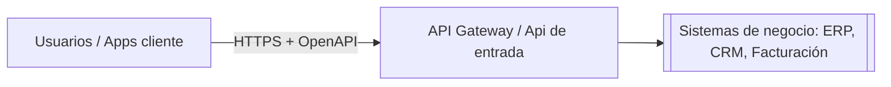
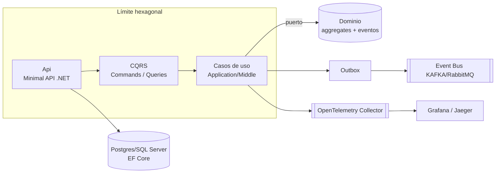
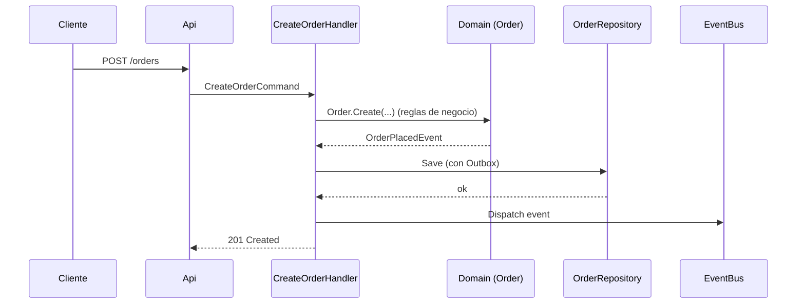

# Arquitectura (C4)

## Contexto (C1)

## Contenedores (C2)

## Componentes (C3) — flujo `CreateOrder`

## Reglas de oro del blueprint

1. **El dominio no conoce nada de infraestructura** — solo `Domain/` puro.
2. **Los casos de uso dependen de interfaces (puertos)**, nunca de implementaciones.
3. **La entrada y la salida son adaptadores** que se conectan por composición en `Program.cs`.
4. **Cada comando/usecase es testeable en aislamiento** (protocolo de la Arquitectura Hexagonal).
5. **Persistencia atómica con Outbox** para no perder eventos (garantía de consistencia eventual).